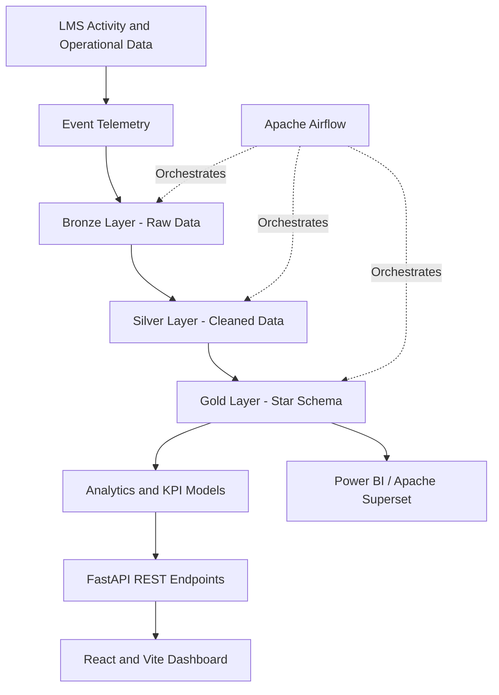

# LMS Analytics Platform

**An End-to-End Learning Management System Analytics Platform** built to demonstrate modern data analytics, business intelligence, data engineering, and full-stack development practices.

The platform transforms learning activity data into actionable insights through interactive dashboards, REST APIs, dimensional modeling, and a Bronze–Silver–Gold ELT architecture.

## Table of Contents

- [Overview](#overview)
- [Key Features](#key-features)
- [Technology Stack](#technology-stack)
- [System Architecture](#system-architecture)
- [Project Structure](#project-structure)
- [Analytics and KPIs](#analytics-and-kpis)
- [Data Warehouse Design](#data-warehouse-design)
- [Getting Started](#getting-started)
- [API Documentation](#api-documentation)
- [Demo Data](#demo-data)
- [Production Roadmap](#production-roadmap)
- [Portfolio and Learning Outcomes](#portfolio-and-learning-outcomes)

## Overview

The LMS Analytics Platform is a professional reference implementation for analyzing activity across a Learning Management System (LMS).

It demonstrates how raw learning events and operational data can be transformed into structured analytical datasets and presented through an interactive dashboard for instructors and administrators.

The project covers the analytics lifecycle, from event collection and data transformation to KPI calculation, API integration, and business intelligence reporting.

### Business Problems Addressed

- Understanding learner engagement and daily activity.
- Tracking course completion and video-watching behavior.
- Evaluating quiz performance and pass rates.
- Monitoring revenue and learning platform performance.
- Providing instructors and administrators with data-driven insights.
- Establishing a scalable foundation for analytics engineering workflows.

## Key Features

### Interactive Analytics Dashboard
- React-based analytics portal powered by Vite.
- Dashboard interface for instructors and administrators.
- KPI summaries and visual analytics.
- API-driven analytics data integration.

### Backend and API
- FastAPI backend with REST endpoints.
- Health-check endpoint for service monitoring.
- Demo analytics endpoints.
- Interactive API documentation through Swagger UI.

### Data Engineering and Analytics
- PostgreSQL-ready operational data model.
- Star-schema analytical warehouse design.
- Bronze, Silver, and Gold ELT layers.
- dbt-style SQL transformation models.
- Apache Airflow orchestration example.
- Learning event telemetry and seed data.
- Data quality and transformation workflow examples.

### Business Intelligence
- Daily and monthly active user metrics.
- Course and video completion analysis.
- Quiz pass-rate monitoring.
- Revenue KPI calculations.
- BI integration planning for Apache Superset and Power BI.

### Local Development
- Docker Compose configuration.
- Separate frontend and backend development workflows.
- Seed/demo data for exploration.
- Architecture, data dictionary, and interview documentation.

## Technology Stack

| Layer | Technologies |
|---|---|
| Frontend | React, Vite, JavaScript |
| Backend | Python, FastAPI, Uvicorn |
| Operational Database | PostgreSQL-ready data model |
| Data Warehouse | Star schema, dimensional modeling |
| Data Transformation | SQL, dbt-style models |
| Orchestration | Apache Airflow example |
| BI and Visualization | Dashboard UI, Apache Superset / Power BI integration roadmap |
| Data Processing | Python, SQL |
| Infrastructure | Docker, Docker Compose |
| API Documentation | OpenAPI, Swagger UI |
| Data Sources | Seed data, learning event telemetry |

## System Architecture



**Architecture flow:**

1. **Data collection:** Capture learning activity events and operational records.
2. **Bronze layer:** Store raw data for subsequent processing.
3. **Silver layer:** Clean, validate, and standardize records.
4. **Gold layer:** Organize curated data into analytical facts and dimensions.
5. **Analytics layer:** Calculate business KPIs using SQL and Python.
6. **API layer:** Expose analytics through FastAPI endpoints.
7. **Presentation layer:** Display results through the React dashboard and support downstream BI integrations.

> Note: PostgreSQL integration, dbt execution, and scheduled Airflow pipelines represent the intended architecture where components are provided as models or examples. The demo's actual runtime behavior depends on the implemented configuration.

## Project Structure

```text
lms-analytics-platform/
├── frontend/
│   ├── src/
│   ├── public/
│   ├── package.json
│   └── vite.config.js
├── backend/
│   ├── app/
│   │   └── main.py
│   └── requirements.txt
├── warehouse/
│   ├── models/
│   │   ├── staging/
│   │   ├── intermediate/
│   │   └── marts/
│   └── README.md
├── airflow/
│   └── dags/
├── data/
│   ├── raw/
│   └── seed/
├── docs/
│   ├── architecture.md
│   ├── data_dictionary.md
│   └── interview_notes.md
├── superset/
│   └── README.md
├── docker-compose.yml
└── README.md
```

*The tree illustrates the intended organization; individual filenames and directories may vary in the actual repository.*

## Analytics and KPIs

The platform demonstrates key performance indicators relevant to online learning businesses.

| KPI | Description |
|---|---|
| Daily Active Users (DAU) | Unique users active during a given day |
| Monthly Active Users (MAU) | Unique users active during a given month |
| Course Completion Rate | Percentage of eligible course enrollments completed |
| Video Watch Completion Rate | Percentage of video content completed under the defined measurement method |
| Quiz Pass Rate | Percentage of eligible quiz attempts that meet the passing threshold |
| Revenue | Revenue generated over a selected reporting period |

### Example KPI Definitions

**Daily Active Users**

Count distinct users with at least one qualifying activity event during the selected day.

**Monthly Active Users**

Count distinct users with at least one qualifying activity event during the selected calendar month.

**Course Completion Rate**

\[
\text{Completion Rate} =
\frac{\text{Completed Eligible Enrollments}}
{\text{Total Eligible Enrollments}} \times 100
\]

**Quiz Pass Rate**

\[
\text{Pass Rate} =
\frac{\text{Passing Quiz Attempts}}
{\text{Eligible Quiz Attempts}} \times 100
\]

**Video Watch Completion Rate**

A possible definition is the percentage of eligible video sessions in which the learner reaches the configured completion threshold. Alternatively, aggregate watched duration can be compared with total available video duration. The chosen definition should be documented consistently.

**Revenue**

Revenue can be aggregated from eligible transaction records, with refund handling and reporting currency defined by the business rules.

*These definitions are reference examples. Production calculations should specify reporting windows, exclusions, time zones, deduplication rules, and denominator logic.*

## Data Warehouse Design

The analytical warehouse follows a star-schema approach to support efficient reporting and business intelligence.

### Example Fact Tables

- `fact_learning_activity` — learner engagement events.
- `fact_course_progress` — enrollment and course completion activity.
- `fact_quiz_attempts` — quiz attempts, scores, and pass outcomes.
- `fact_transactions` — transaction amounts and revenue-related events.

### Example Dimension Tables

- `dim_user` — learner and user attributes.
- `dim_course` — course metadata.
- `dim_instructor` — instructor information.
- `dim_date` — calendar and reporting attributes.

The final table names and columns should align with the SQL models implemented in the repository.

### ELT Layers

| Layer | Purpose |
|---|---|
| Bronze | Preserve source data and raw learning events |
| Silver | Clean, standardize, deduplicate, and validate records |
| Gold | Publish curated fact and dimension models for analytics |

The separation of these layers makes data lineage easier to understand and helps isolate data quality issues before they affect business reporting.

## Getting Started

### Prerequisites

Install the following tools before running the project:

- Docker Desktop and Docker Compose, or compatible Docker Engine tooling.
- Node.js and npm for standalone frontend development.
- Python and pip for standalone backend development.

For local development, ensure the required ports are available.

### Option 1: Run with Docker Compose

Clone the repository and navigate to the project directory.

```bash
git clone <YOUR_REPOSITORY_URL>
cd lms-analytics-platform
```

Start the configured services:

```bash
docker compose up --build
```

Once the services have started successfully, access the configured endpoints:

| Service | URL |
|---|---|
| Frontend | http://localhost:5173 |
| Backend API | http://localhost:8000 |
| API documentation | http://localhost:8000/docs |
| PostgreSQL | localhost:5432 |

**Important:** The PostgreSQL endpoint is applicable when the database service is configured and running in Docker Compose. Verify the actual service definitions and port mappings in `docker-compose.yml`.

### Option 2: Run the Frontend Locally

Open a terminal in the project root:

```bash
cd frontend
npm install
npm run dev
```

Open the local URL displayed by Vite, typically:

```text
http://localhost:5173
```

### Option 3: Run the Backend Locally

Open a separate terminal:

```bash
cd backend
python -m venv .venv
```

Activate the virtual environment.

**macOS / Linux**

```bash
source .venv/bin/activate
```

**Windows PowerShell**

```powershell
.venv\Scripts\Activate.ps1
```

Install the dependencies:

```bash
pip install -r requirements.txt
```

Start the API server:

```bash
uvicorn app.main:app --reload --port 8000
```

The API should be available at:

- API base URL: http://localhost:8000
- Interactive API documentation: http://localhost:8000/docs

If your backend uses a different application module or requires environment variables, follow the repository's implementation and configuration files.

## API Documentation

FastAPI provides interactive API documentation through Swagger UI.

After starting the backend, open:

http://localhost:8000/docs

Use this interface to inspect available routes, review request and response schemas, and test the implemented endpoints.

The demo includes a health endpoint and analytics endpoints as described by the project configuration. Exact route names and response formats should be verified in the source code.

## Demo Data

The project includes seed/demo data and learning event examples to support local exploration and dashboard demonstrations.

Example analytical scenarios include:

- Tracking learner activity over time.
- Comparing course completion performance.
- Reviewing quiz outcomes.
- Analyzing video engagement.
- Summarizing revenue-related metrics.

Demo data is intended for development, testing, and portfolio demonstrations. It should not be interpreted as real customer or production business data.

## Production Roadmap

The following enhancements would move the reference implementation toward a production-grade analytics platform.

- **Persistent storage:** Replace the in-memory analytics repository with PostgreSQL-backed repositories.
- **Automated transformations:** Configure dbt, including sources, tests, documentation, and materialized Gold models.
- **Workflow orchestration:** Deploy Airflow DAGs with scheduling, retries, logging, and failure notifications.
- **Event streaming:** Integrate Kafka or a telemetry provider such as RudderStack or Segment.
- **Business intelligence:** Connect Power BI or Apache Superset directly to curated Gold-layer datasets.
- **Data quality:** Add uniqueness, not-null, referential-integrity, freshness, and business-rule checks.
- **Security:** Implement authentication, role-based access control, secrets management, and appropriate audit logging.
- **Observability:** Monitor API performance, pipeline failures, data freshness, and KPI anomalies.
- **Testing and CI/CD:** Add automated backend and frontend tests, SQL model tests, and deployment workflows.

## Portfolio and Learning Outcomes

This project demonstrates practical skills across data analytics, business intelligence, backend development, and analytics engineering.

**Core competencies demonstrated:**

- SQL and business KPI design.
- Data modeling and star-schema concepts.
- Bronze–Silver–Gold ELT architecture.
- Python and REST API development.
- React-based analytics dashboard development.
- Data quality and transformation concepts.
- Docker-based local development.
- Data pipeline orchestration concepts.
- BI architecture and reporting integration.

### Relevant Roles

- Data Analyst
- Business Intelligence Analyst
- Power BI Developer
- SQL Analyst
- Reporting Analyst / MIS Analyst
- Analytics Engineer
- Junior Data Engineer

## Future Enhancements

Potential future extensions include learner cohort analysis, course funnel analytics, retention tracking, instructor performance reporting, automated anomaly detection, configurable date filters, and predictive learner engagement models.

## Disclaimer

This repository is an educational and portfolio-oriented reference implementation. Features described as examples, architectural patterns, or future enhancements should not be interpreted as fully deployed production capabilities unless verified in the implementation.

---

**Built to demonstrate end-to-end analytics thinking — from learning events and data modeling to APIs, dashboards, and actionable business insights.**
